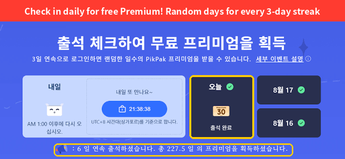
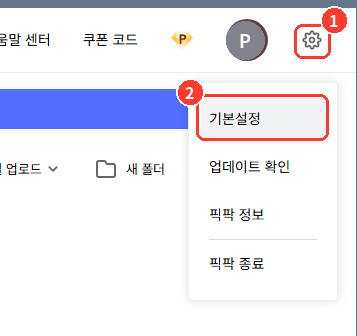
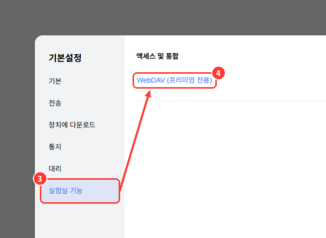
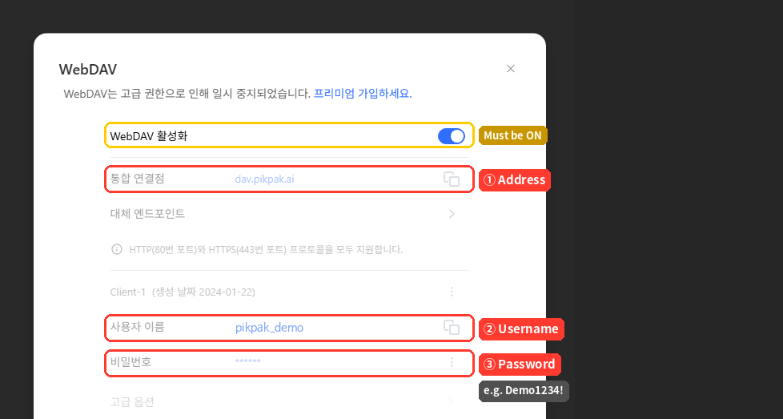
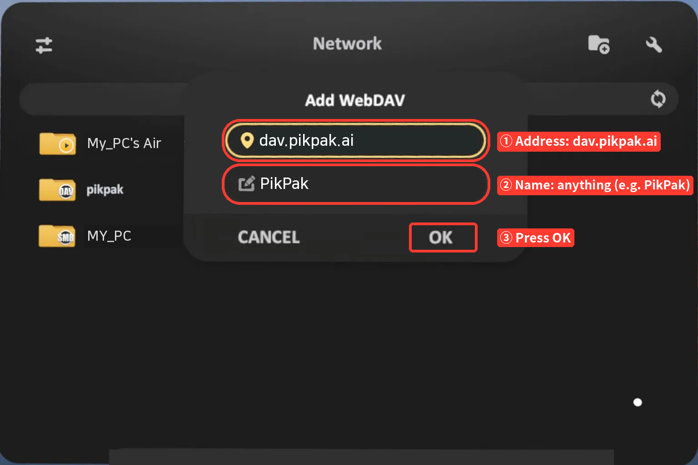
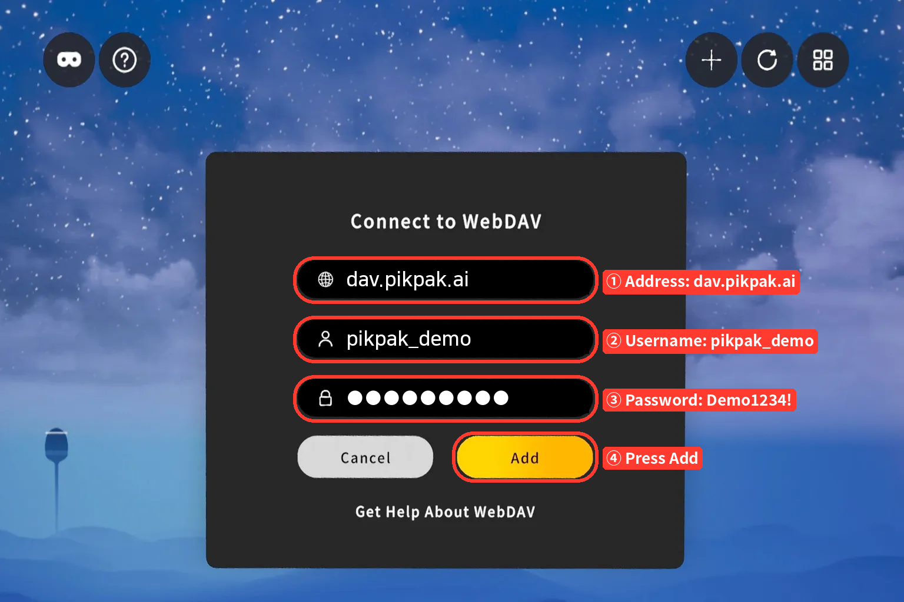

**🌐 [한국어](README.md) | [English](README.en.md) | [日本語](README.ja.md) | [简体中文](README.zh-CN.md)**

# The Complete PikPak Guide

> As of: 2026-11-25
> Items marked `[Unverified]` could not be confirmed from official sources yet.
> Screenshots were taken with the Korean app interface. Menu names in your language may differ slightly.

> [!TIP]
> **Signing up for the first time? Please enter referral code `64342028`.**
> 👉 [Sign up with the referral link](https://mypikpak.com/drive/activity/invited?invitation-code=64342028)

## Contents

1. [What is PikPak](#what-is-pikpak)
2. [Sign up and install](#sign-up-and-install)
3. [Referral code](#referral-code)
4. [Daily check-in for free Premium](#daily-check-in-for-free-premium)
5. [Uploading and downloading files](#uploading-and-downloading-files)
6. [Cloud download (offline download)](#cloud-download-offline-download)
7. [Sharing](#sharing)
8. [Video playback](#video-playback)
9. [Finding your WebDAV account](#finding-your-webdav-account)
10. [Connecting PikPak to 4XVR](#connecting-pikpak-to-4xvr)
11. [Plans and pricing](#plans-and-pricing)
12. [Tips](#tips)
13. [Things to watch out for](#things-to-watch-out-for)
14. [Sources](#sources)

---

## What is PikPak

PikPak is a **cloud drive that downloads files for you on its servers when you give it a link**. It is run by PIKCLOUD PTE. LTD. in Singapore, and you can preview photos and play videos right after they are saved.

What sets it apart from ordinary cloud storage like Google Drive or OneDrive:

- **Cloud download:** The server fetches files for you, so your PC doesn't need to stay on.
- **Instant playback:** Stream saved videos on the web or in the app without downloading them.
- **WebDAV support:** Open PikPak like a drive in VR players or file manager apps (Premium only).
- **Telegram bot:** Send files or links to the bot and they are saved to PikPak.
- **Vault:** An end-to-end encrypted private space added in version 2.0, unlocked with a passcode or biometrics.

The latest addition (iOS 2.3.0, November 7, 2026) is **AI subtitles** that generate and translate subtitles automatically.

---

## Sign up and install

Sign up on the web (mypikpak.com) or in the mobile app with an email address or a Google account. You get **6GB of free storage** just for signing up. Don't forget to enter the [referral code](#referral-code).

| Device | Where to get it | Notes |
| --- | --- | --- |
| Web | mypikpak.com web drive | No install needed |
| iPhone / iPad | App Store | iOS 15.0 or later |
| Android | Google Play `[Unverified]` | An Android TV app also exists `[Unverified]` |
| Windows / macOS | Official website `[Unverified]` | Better for downloading many files at once |
| Browser extension | `[Unverified]` | Save links straight from the web |

> [!WARNING]
> Only install the app from **official app stores or the official website**. Modified APKs with look-alike names can put your account at risk.

---

## Referral code

When signing up, open the link below or enter the referral code yourself.

| Method | Details |
| --- | --- |
| Sign up via link | [https://mypikpak.com/drive/activity/invited?invitation-code=64342028](https://mypikpak.com/drive/activity/invited?invitation-code=64342028) |
| Enter code | **`64342028`** |

Details of the referral reward are `[Unverified]`.

---

## Daily check-in for free Premium

> [!IMPORTANT]
> ### Check in every day and get Premium for free
> 👉 **[https://mypikpak.com/ko/check-in?from_source=pp_browser_extension](https://mypikpak.com/ko/check-in?from_source=pp_browser_extension)**

Check in (log in) **3 days in a row to receive a random number of Premium days**. It adds up quickly if you keep at it. The screenshot below shows a 6-day streak that earned 30 Premium days that day.

- The check-in resets at **midnight Singapore time (UTC+8)**. That is **1:00 AM** in Korea and Japan (UTC+9).
- Bookmark the check-in page and tap it once a day.

---

## Uploading and downloading files

There are three ways to upload your own files:

1. Press **Upload** in the app or on the web and pick files.
2. From your phone's gallery or another app, choose **Share → PikPak**.
3. Forward a file to the **PikPak bot** in Telegram.

To save a file to your device, long-press it and choose **Download**.

- The iPhone app can't download many files at once. The developer recommends the **Windows app** for this (App Store review reply, 2023).
- Upload quotas and download speed limits for free users are reported to exist, but the exact numbers are `[Unverified]`.

---

## Cloud download (offline download)

This is PikPak's core feature. Paste a file link and **PikPak's servers download it into your drive**. It keeps going even if you close the app.

### Steps

1. Press the **+ (Add)** button in the app or on the web and choose **Add link**. `[Unverified: menu name]`
2. Paste the link to the file.
3. Press **Confirm** and the cloud download starts.
4. When it finishes, the file appears in your drive, ready to play or download.

### Supported links

- Regular file links (HTTP/HTTPS)
- Magnet links and torrent files
- Some social media video links

Daily and total cloud download limits for free users are `[Unverified]`.

### Good (legal) uses

- **Large files that official sources distribute via torrent**, such as Linux ISO images
- **Public domain or Creative Commons** videos and materials
- Files you own the rights to, or files friends have properly shared with you

> [!TIP]
> **Smart incremental saving** (2.2.0): when you save the same folder again, only new files are saved, so there are no duplicates.

---

## Sharing

Select a file or folder and press **Share** to create a share link. Options such as passwords and expiry dates are `[Unverified]`.

- **Share Updates tab** (2.2.0): see new updates from shares you follow on the home screen.
- **Manage shares** (2.3.0): keep all the shares you follow in one place under "Shares".
- **Encrypted Vault sharing** (2.0): Vault files can be shared while staying encrypted.

> [!NOTE]
> Before saving someone else's share link, make sure the content is legal. Illegal content can be reported in the app.

---

## Video playback

Saved videos play instantly without downloading. Resolution adjusts to your network automatically, reportedly up to 4K `[Unverified]`.

- **AI subtitles** (2.3.0): generate and translate subtitles automatically, and set subtitle priority.
- **Pinch to zoom** (2.1.1): zoom in the player with two fingers.
- **Online archive extraction** (2.1.1): open more archive formats directly online.

To watch on a big screen in VR, connect via [WebDAV](#finding-your-webdav-account).

---

## Finding your WebDAV account

WebDAV lets VR players like 4XVR or file manager apps open PikPak like your own drive. You need three things: **address, username, and password**.

> [!IMPORTANT]
> WebDAV is a **Premium-only** feature. When Premium ends, WebDAV is paused too.

> The account in these screenshots (`pikpak_demo` / `Demo1234!`) is an example. Use the values shown on your own screen.

### Step 1. Open Settings

In the PC app (or on the web), click the **gear icon (①)** at the top right and choose **Settings (기본설정) (②)**.

### Step 2. Labs → WebDAV

In the left menu, click **Labs (실험실 기능) (③)**, then click **WebDAV (Premium only) (④)** on the right.

### Step 3. Note your connection details

Make sure **Enable WebDAV (WebDAV 활성화)** is on, then note the three values below.

| No. | Label in PikPak | Field when connecting | Example |
| --- | --- | --- | --- |
| ① | Unified endpoint (통합 연결점) | Address | `dav.pikpak.ai` |
| ② | Username (사용자 이름) | Username | `pikpak_demo` |
| ③ | Password (비밀번호) | Password | `Demo1234!` |

- The password is **not your PikPak login password**. It is the WebDAV-only password shown in this window. You can view or create it from the **⋮ menu** to the right of the password row. `[Unverified: menu name]`
- Press the copy button next to the address to copy it.
- Both HTTP (port 80) and HTTPS (port 443) are supported.

---

## Connecting PikPak to 4XVR

Enter the account from above in the [4XVR](https://www.4xvr.net/kor/h-nd-131.html) player and you can watch PikPak videos right inside VR.

### Step 1. Add a WebDAV server

On the **Network** screen, press the **+** button at the top right and choose **WebDAV**. The **Add WebDAV** window appears.

| Field | What to enter |
| --- | --- |
| ① Address field | `dav.pikpak.ai` (the **unified endpoint** from PikPak) |
| ② Server Name (Optional) | Any name, e.g. `PikPak` (can be left blank) |
| ③ OK | Press to save |

### Step 2. Enter the account and connect

Open the server you added and the **Connect to WebDAV** window appears. Enter the values from PikPak exactly.

| Field | What to enter | Example |
| --- | --- | --- |
| ① Address | PikPak **unified endpoint** | `dav.pikpak.ai` |
| ② Username (Optional) | PikPak **username** | `pikpak_demo` |
| ③ Password (Optional) | PikPak WebDAV **password** | `Demo1234!` |
| ④ Add | Press to connect | |

Once connected, a PikPak folder appears in the network list, and you can play its videos in VR.

### If it won't connect

- Check that your **Premium is active** and **Enable WebDAV** is on in the WebDAV window.
- The username and password must be the **values from the WebDAV window**, not your PikPak login email and password.
- Use the **unified endpoint shown on your own PikPak screen**. Older screens and other guides may show `dav.mypikpak.com`. If it doesn't work, try the address under **Alternative endpoint (대체 엔드포인트)** in the WebDAV window. `[Unverified]`
- If the address alone doesn't work, try adding `https://` in front. `[Unverified]`

---

## Plans and pricing

Free gets 6GB, Premium gets 10TB. Prices vary by country. Before paying, try getting Premium for free with the [daily check-in](#daily-check-in-for-free-premium).

| Plan | Storage | Price (US App Store, as of 2026-11-25) |
| --- | --- | --- |
| Free | 6GB | Free |
| Premium monthly | 10TB | $4.99 / month |
| Premium yearly | 10TB | $49.99 / year |
| Global Premium monthly | 10TB `[Unverified]` | $9.99 / month |
| Global Premium yearly | 10TB `[Unverified]` | $99.99 / year |
| 10TB extra storage | +10TB | $43.49 / 1 year |

- The same App Store description says $10.0 per month and $100.99 per year, which differs from the purchase list. `[Unverified]`
- The official help center has a separate page on **Global Premium vs Regional Premium** (e.g. where each can be used). Details are `[Unverified]`.
- Extra Vault storage can be purchased separately (2.1.1).

---

## Tips

- **Daily check-in:** earn Premium days for every 3-day streak. [Go there](#daily-check-in-for-free-premium)
- **Telegram bot:** send links to the bot to save them without opening the app.
- **Use the PC app for bulk downloads:** much easier than on mobile.
- **Change the start screen** (2.2.1): set the app to open straight to "Files".
- **Watch in VR:** connect to 4XVR via WebDAV and play directly in VR. [Go there](#connecting-pikpak-to-4xvr)

---

## Things to watch out for

### Copyright

- **Don't download or share files without the rights holder's permission**, such as movies, TV shows, or paid software. Even if the cloud downloaded it, you are responsible for copyright infringement.
- Account restriction policy for violations `[Unverified]`

### Security and privacy

- Buy Premium **only in the official app or on the official website**. PikPak's official blog also warns against buying from unofficial resellers.
- **Never show your WebDAV password to others.** Hide your username and password when posting screenshots.
- According to the App Store privacy label, the app uses **identifiers for tracking** and links **email and phone number** to your account.
- Keep sensitive files in the **Vault**. You get an email alert when the Vault password is changed or reset (2.1.1).
- Two-factor authentication support `[Unverified]`
- Some users report service outages, so **keep backups of important originals elsewhere**.

---

## Sources

- [App Store: PikPak - Cloud Storage & Saver](https://apps.apple.com/us/app/pikpak-cloud-storage-saver/id1616861537) (features, in-app purchase prices, version history, privacy label. Checked 2026-11-25)
- [4XVR: WebDAV connection](https://www.4xvr.net/kor/h-nd-131.html) (how to add a WebDAV server in 4XVR)
- [AxeeTech: PikPak Review 2026](https://axeetech.com/pikpak-review/) (supported devices, link types, 4K playback. Third-party review, updated 2026-11-13)
- PikPak PC app screens (WebDAV menu location, check-in screen. Captured 2026-11-25, account details replaced with examples)
