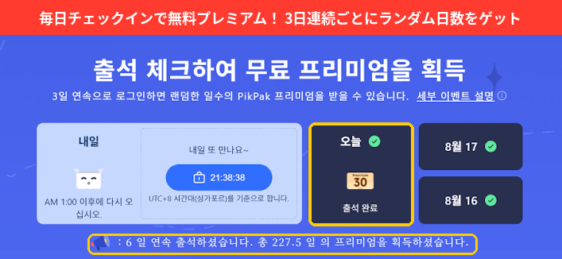
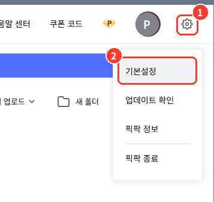
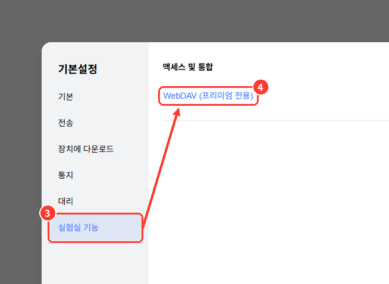
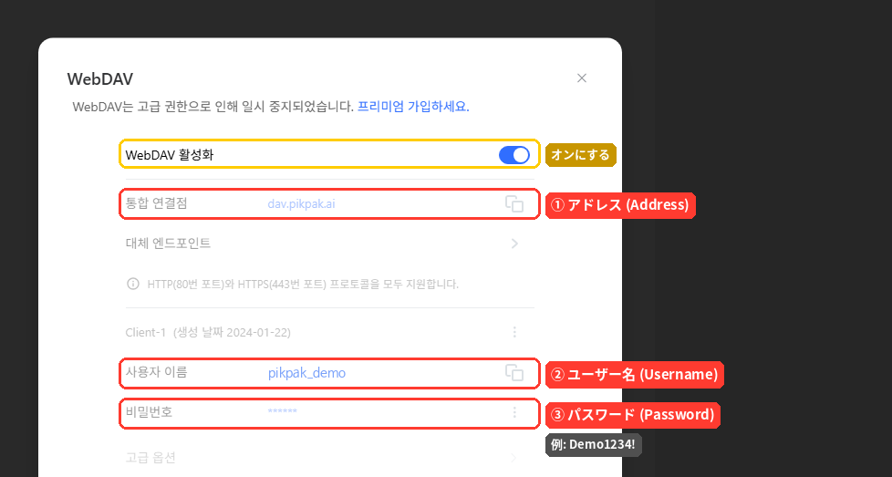
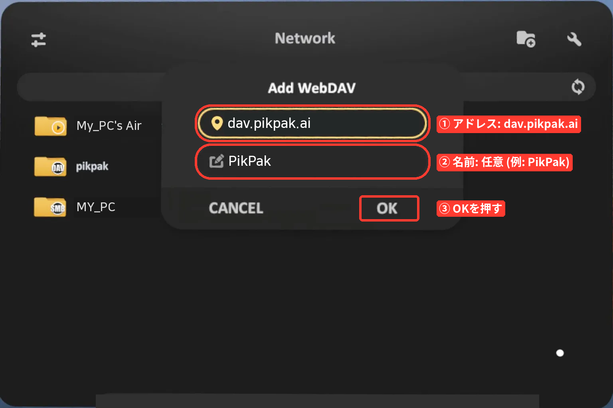
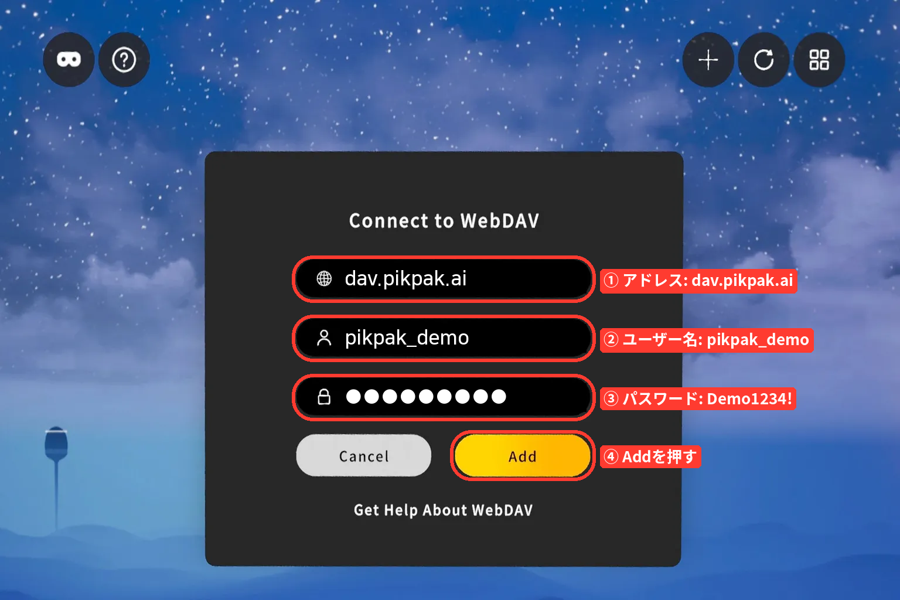

**🌐 [한국어](README.md) | [English](README.en.md) | [日本語](README.ja.md) | [简体中文](README.zh-CN.md)**

# PikPak 完全ガイド

> 基準日：2026-11-25
> `[要確認]` は公式情報でまだ確認できていない内容です。
> スクリーンショットは韓国語版アプリの画面です。お使いの言語ではメニュー名が少し異なる場合があります。

> [!TIP]
> **初めて登録する方は、招待コード `64342028` を入力してください。**
> 👉 [招待リンクから登録する](https://mypikpak.com/drive/activity/invited?invitation-code=64342028)

## 目次

1. [PikPakとは](#pikpakとは)
2. [登録とインストール](#登録とインストール)
3. [招待コード](#招待コード)
4. [毎日チェックインで無料プレミアム](#毎日チェックインで無料プレミアム)
5. [ファイルのアップロードとダウンロード](#ファイルのアップロードとダウンロード)
6. [クラウドダウンロード](#クラウドダウンロード)
7. [共有](#共有)
8. [動画再生](#動画再生)
9. [WebDAVアカウントの確認](#webdavアカウントの確認)
10. [4XVRでPikPakに接続](#4xvrでpikpakに接続)
11. [料金プラン比較](#料金プラン比較)
12. [活用のヒント](#活用のヒント)
13. [注意点](#注意点)
14. [出典](#出典)

---

## PikPakとは

PikPakは、**リンクを入れるだけで、パソコンの代わりにクラウドがファイルをダウンロードして保存してくれるクラウドドライブ**です。シンガポールのPIKCLOUD PTE. LTD.が運営しており、保存したファイルはすぐに写真のプレビューや動画の再生ができます。

Google ドライブや OneDrive などの一般的なクラウドとの大きな違いは次のとおりです。

- **クラウドダウンロード：** パソコンをつけっぱなしにしなくても、サーバーが代わりにダウンロードします。
- **すぐに再生：** 保存した動画をダウンロードせず、Webやアプリでストリーミング再生できます。
- **WebDAV対応：** VRプレイヤーやファイル管理アプリからPikPakをドライブのように開けます（プレミアム限定）。
- **Telegramボット連携：** Telegramでファイルやリンクをボットに送るとPikPakに保存されます。
- **金庫（Vault）：** バージョン2.0で追加されたエンドツーエンド暗号化の個人スペースです。パスコードや生体認証で開きます。

最新の追加機能（iOS 2.3.0、2026年11月7日）は **AI字幕の自動生成・翻訳** です。

---

## 登録とインストール

Web（mypikpak.com）またはモバイルアプリで、メールアドレスかGoogleアカウントで登録します。登録するだけで **6GBの無料ストレージ** がもらえます。登録時に[招待コード](#招待コード)の入力もお忘れなく。

| デバイス | 入手先 | メモ |
| --- | --- | --- |
| Web | mypikpak.com Webドライブ | インストール不要 |
| iPhone・iPad | App Store | iOS 15.0 以降 |
| Android | Google Play `[要確認]` | Android TV版もあり `[要確認]` |
| Windows・macOS | 公式サイト `[要確認]` | 複数ファイルの一括ダウンロードに便利 |
| ブラウザ拡張機能 | `[要確認]` | Webからリンクをそのまま保存 |

> [!WARNING]
> アプリは必ず **公式ストアまたは公式サイト** からインストールしてください。名前が似ている改造版APKはアカウント乗っ取りの危険があります。

---

## 招待コード

登録時に下のリンクから入るか、招待コードを直接入力してください。

| 方法 | 内容 |
| --- | --- |
| リンクから登録 | [https://mypikpak.com/drive/activity/invited?invitation-code=64342028](https://mypikpak.com/drive/activity/invited?invitation-code=64342028) |
| コードを入力 | **`64342028`** |

招待特典の具体的な内容は `[要確認]` です。

---

## 毎日チェックインで無料プレミアム

> [!IMPORTANT]
> ### 毎日チェックインするとプレミアムが無料でもらえます
> 👉 **[https://mypikpak.com/ko/check-in?from_source=pp_browser_extension](https://mypikpak.com/ko/check-in?from_source=pp_browser_extension)**

**3日連続でチェックイン（ログイン）すると、ランダムな日数のプレミアム** がもらえます。続けるとかなり貯まります。下の画面は6日連続チェックインで、その日にプレミアム30日分をもらった例です。

- チェックインは **シンガポール時間（UTC+8）の午前0時** にリセットされます。日本時間では **午前1時以降** に次のチェックインができます。
- チェックインページをブックマークして、毎日1回押しましょう。

---

## ファイルのアップロードとダウンロード

自分のファイルをアップロードする方法は3つあります。

1. アプリやWebで **アップロード** ボタンを押してファイルを選びます。
2. スマホのギャラリーや他のアプリで **共有 → PikPak** を選びます。
3. Telegramでファイルを **PikPakボット** に転送します。

端末に保存するときは、ファイルを長押しして **ダウンロード** を選びます。

- iPhoneアプリは複数ファイルの一括ダウンロードに対応していません。開発元もこの場合は **Windowsアプリ** を勧めています（App Storeレビューへの返信、2023年）。
- 無料ユーザーにはアップロード容量やダウンロード速度の制限があるとされていますが、正確な数値は `[要確認]` です。

---

## クラウドダウンロード

PikPakの中心機能です（オフラインダウンロードとも呼ばれます）。ファイルのリンクを入れると **PikPakのサーバーが代わりにダウンロードしてドライブに保存** します。アプリを閉じても続行されます。

### 使い方

1. アプリまたはWebで **＋（追加）** ボタンを押し、**リンクを追加** を選びます。`[要確認：メニュー名]`
2. ダウンロードしたいファイルのリンクを貼り付けます。
3. **確認** を押すとクラウドでダウンロードが始まります。
4. 完了するとドライブにファイルが表示され、すぐに再生やダウンロードができます。

### 使えるリンク

- 通常のファイルリンク（HTTP/HTTPS）
- マグネットリンク、トレントファイル
- 一部のSNS動画リンク

無料ユーザーの1日あたり・合計のクラウドダウンロード回数制限は `[要確認]` です。

### おすすめの使い方（合法的な例）

- LinuxのISOのように **公式配布元がトレントで提供している大きなファイル**
- **パブリックドメインやCCライセンス** の動画・資料
- 自分が権利を持つファイル、知人から正式に共有されたファイル

> [!TIP]
> **スマート増分保存**（2.2.0）：同じフォルダを再保存すると新しいファイルだけが保存され、重複しません。

---

## 共有

ファイルやフォルダを選んで **共有** を押すと共有リンクが作成されます。パスワードや有効期限などの詳細オプションは `[要確認]` です。

- **共有アップデートタブ**（2.2.0）：ホーム画面でフォロー中の共有の更新を確認できます。
- **共有の管理**（2.3.0）：フォロー中の共有を「共有」メニューでまとめて管理できます。
- **金庫の暗号化共有**（2.0）：金庫のファイルも暗号化したまま共有できます。

> [!NOTE]
> 他人の共有リンクを保存する前に、内容が合法か確認しましょう。違法コンテンツはアプリから報告できます。

---

## 動画再生

保存した動画はダウンロードせずにすぐ再生できます。解像度は回線に合わせて自動で変わり、最大4Kに対応するとされています `[要確認]`。

- **AI字幕**（2.3.0）：字幕を自動で生成・翻訳します。字幕の優先順位も設定できます。
- **ピンチズーム**（2.1.1）：プレイヤーで2本指で拡大できます。
- **圧縮ファイルのオンライン展開**（2.1.1）：より多くの圧縮形式をオンラインで直接開けます。

VRの大画面で見たい場合は、下の [WebDAV](#webdavアカウントの確認) で接続します。

---

## WebDAVアカウントの確認

WebDAVを使うと、4XVRなどのVRプレイヤーやファイル管理アプリからPikPakを自分のドライブのように開けます。接続に必要なのは **アドレス、ユーザー名、パスワード** の3つです。

> [!IMPORTANT]
> WebDAVは **プレミアム限定** 機能です。プレミアムが切れるとWebDAVも一時停止されます。

> 画面のアカウント（`pikpak_demo` / `Demo1234!`）は説明用の例です。実際は自分の画面に表示される値を使ってください。

### ステップ1. 基本設定を開く

PCアプリ（またはWeb）右上の **歯車アイコン（①）** を押し、**基本設定（기본설정）（②）** を選びます。

### ステップ2. ラボ機能 → WebDAV

左のメニューで **ラボ機能（실험실 기능）（③）** を押し、右側の **WebDAV（プレミアム限定）（④）** を押します。

### ステップ3. 接続情報を確認

**WebDAVを有効化（WebDAV 활성화）** がオンになっているか確認し、次の3つの値をメモします。

| 番号 | PikPakでの表示 | 接続時に入れる欄 | 例 |
| --- | --- | --- | --- |
| ① | 統合エンドポイント（통합 연결점） | アドレス (Address) | `dav.pikpak.ai` |
| ② | ユーザー名（사용자 이름） | ユーザー名 (Username) | `pikpak_demo` |
| ③ | パスワード（비밀번호） | パスワード (Password) | `Demo1234!` |

- このパスワードは **PikPakのログインパスワードではなく**、この画面に表示されるWebDAV専用のパスワードです。パスワード行の右側にある **⋮ メニュー** から確認・新規作成できます。`[要確認：メニュー名]`
- アドレス右のコピーボタンでアドレスをすぐにコピーできます。
- HTTP（80番ポート）とHTTPS（443番ポート）の両方に対応しています。

---

## 4XVRでPikPakに接続

[4XVR](https://www.4xvr.net/kor/h-nd-131.html) プレイヤーに上で確認したアカウントを入れると、VRの中でPikPakの動画をすぐに見られます。

### ステップ1. WebDAVサーバーを追加

**Network（ネットワーク）** 画面右上の **＋** ボタンを押して **WebDAV** を選ぶと、**Add WebDAV** 画面が表示されます。

| 欄 | 入れる値 |
| --- | --- |
| ① アドレス欄 | `dav.pikpak.ai`（PikPakの **統合エンドポイント**） |
| ② Server Name (Optional) | 任意の名前。例：`PikPak`（空欄でもOK） |
| ③ OK | 押して保存 |

### ステップ2. アカウントを入力して接続

追加したサーバーを開くと **Connect to WebDAV** 画面が表示されます。PikPakで確認した値をそのまま入れてください。

| 欄 | 入れる値 | 例 |
| --- | --- | --- |
| ① Address | PikPakの **統合エンドポイント** | `dav.pikpak.ai` |
| ② Username (Optional) | PikPakの **ユーザー名** | `pikpak_demo` |
| ③ Password (Optional) | PikPakの WebDAV **パスワード** | `Demo1234!` |
| ④ Add | 押して接続 | |

接続されるとネットワーク一覧にPikPakのフォルダが表示され、その中の動画をVRで再生できます。

### 接続できないとき

- PikPakの **プレミアムが有効か**、WebDAV画面の **WebDAVを有効化** がオンになっているか確認してください。
- ユーザー名とパスワードは **WebDAV画面に表示された値** です。PikPakのログイン用メールアドレスやパスワードではありません。
- アドレスは必ず **自分のPikPak画面の統合エンドポイント** を使ってください。古い画面や他の案内では `dav.mypikpak.com` と表示されることもあります。つながらない場合はWebDAV画面の **代替エンドポイント（대체 엔드포인트）** のアドレスを試してください。`[要確認]`
- アドレスだけでつながらない場合は、先頭に `https://` を付けてみてください。`[要確認]`

---

## 料金プラン比較

無料は6GB、プレミアムは10TBです。価格は国によって異なります。課金する前に、[毎日チェックイン](#毎日チェックインで無料プレミアム) で無料のプレミアムを試してみましょう。

| 区分 | ストレージ | 価格（米国App Store、2026-11-25時点） |
| --- | --- | --- |
| 無料 | 6GB | 無料 |
| Premium 月額 | 10TB | $4.99 / 月 |
| Premium 年額 | 10TB | $49.99 / 年 |
| Global Premium 月額 | 10TB `[要確認]` | $9.99 / 月 |
| Global Premium 年額 | 10TB `[要確認]` | $99.99 / 年 |
| 10TB 追加容量 | +10TB | $43.49 / 1年 |

- 同じApp Storeの説明文には月 $10.0、年 $100.99 と書かれており、購入リストの価格と異なります。`[要確認]`
- **Global PremiumとRegional Premiumの違い**（利用できる地域など）は公式ヘルプに別ページがあります。詳細は `[要確認]` です。
- 金庫（Vault）の容量は別途購入できます（2.1.1）。

---

## 活用のヒント

- **毎日チェックイン：** 3日連続ごとにプレミアム日数がもらえます。[移動](#毎日チェックインで無料プレミアム)
- **Telegramボット：** アプリを開かずにリンクをボットに送ってすぐ保存できます。
- **一括ダウンロードはPCアプリで：** モバイルより一括ダウンロードが簡単です。
- **起動画面の変更**（2.2.1）：アプリが「ファイル」画面で開くように設定できます。
- **VRで見る：** WebDAVで4XVRに接続すればVRで直接再生できます。[移動](#4xvrでpikpakに接続)

---

## 注意点

### 著作権

- 映画・ドラマ・有料ソフトなど、**権利者が許可していないファイルをダウンロード・共有しないでください。** クラウドがダウンロードした場合でも、著作権侵害の責任は利用者にあります。
- 違反時のアカウント制限ポリシー `[要確認]`

### セキュリティとプライバシー

- プレミアムは **公式アプリ・公式サイトでのみ** 購入してください。PikPak公式ブログにも非公式販売店での購入に関する注意記事があります。
- **WebDAVのパスワードは他人に見せないでください。** スクリーンショットを投稿するときはユーザー名とパスワードを隠しましょう。
- App Storeのプライバシー情報によると、アプリは **トラッキング用の識別子** を使い、**メールアドレス・電話番号** をアカウントと紐づけます。
- 大切なファイルは **金庫（Vault）** に入れましょう。金庫のパスワードを変更・リセットするとメール通知が届きます（2.1.1）。
- 二段階認証への対応 `[要確認]`
- サービス障害があったという声もあるため、**大切な元データは別の場所にもバックアップ** しておきましょう。

---

## 出典

- [App Store: PikPak - Cloud Storage & Saver](https://apps.apple.com/us/app/pikpak-cloud-storage-saver/id1616861537)（機能説明、アプリ内課金の価格、バージョン履歴、プライバシー情報。2026-11-25確認）
- [4XVR: WebDAV接続](https://www.4xvr.net/kor/h-nd-131.html)（4XVRでWebDAVサーバーを追加する手順）
- [AxeeTech: PikPak Review 2026](https://axeetech.com/pikpak-review/)（対応デバイス、リンクの種類、4K再生など。第三者レビュー、2026-11-13更新）
- PikPak PCアプリの画面（WebDAVメニューの場所、チェックイン画面。2026-11-25撮影、アカウント情報は例に置き換え）
