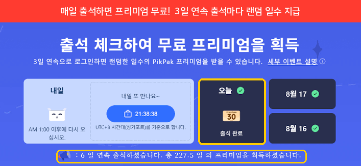
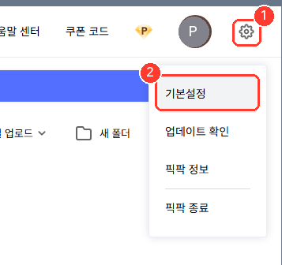
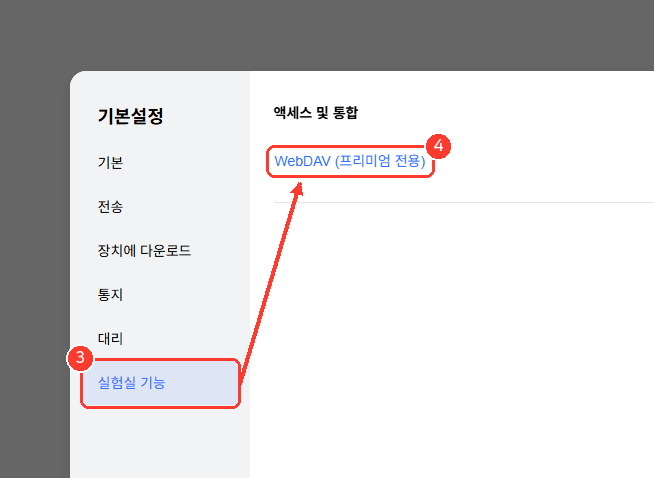
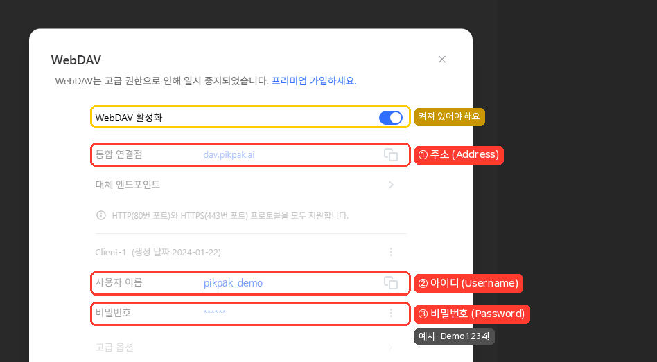
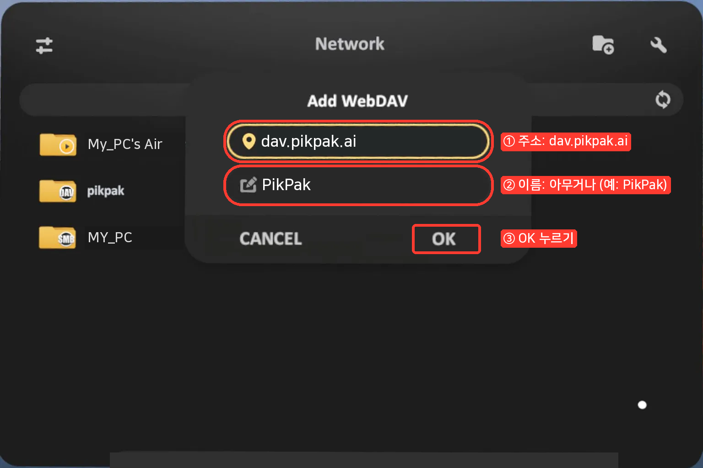
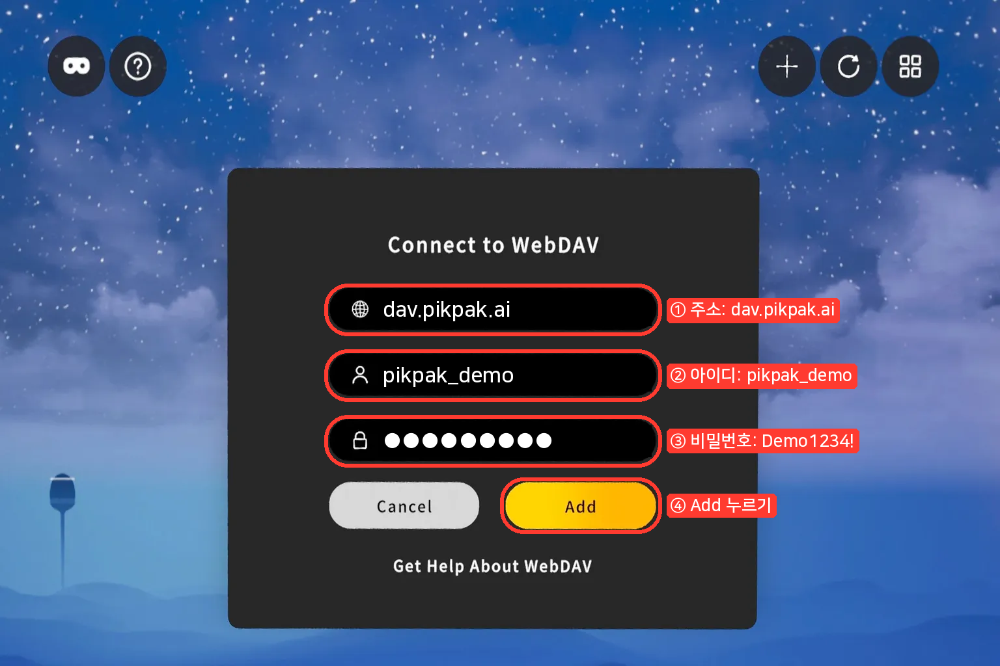

# 픽팍(PikPak) 완벽 사용법

> 기준일: 2026-11-25
> `[확인 필요]` 표시는 공식 자료로 아직 확인하지 못한 내용이에요.

> [!TIP]
> **처음 가입한다면 추천인 코드 `64342028`을 넣어 주세요.**
> 👉 [추천인 링크로 가입하기](https://mypikpak.com/drive/activity/invited?invitation-code=64342028)

## 목차

1. [픽팍이 뭔가요](#픽팍이-뭔가요)
2. [가입과 설치](#가입과-설치)
3. [추천인 코드](#추천인-코드)
4. [매일 출석 체크로 프리미엄 받기](#매일-출석-체크로-프리미엄-받기)
5. [파일 업로드와 다운로드](#파일-업로드와-다운로드)
6. [클라우드 다운로드(오프라인 다운로드)](#클라우드-다운로드오프라인-다운로드)
7. [공유하기](#공유하기)
8. [동영상 재생](#동영상-재생)
9. [WebDAV 계정 확인하기](#webdav-계정-확인하기)
10. [4XVR에서 픽팍 연결하기](#4xvr에서-픽팍-연결하기)
11. [요금제 비교](#요금제-비교)
12. [활용 팁](#활용-팁)
13. [주의할 점](#주의할-점)
14. [출처](#출처)

---

## 픽팍이 뭔가요

픽팍(PikPak)은 **링크만 넣으면 파일을 내 컴퓨터 대신 클라우드가 받아 저장해 주는 클라우드 드라이브**예요. 싱가포르의 PIKCLOUD PTE. LTD.가 운영하고, 받은 파일은 바로 사진·동영상으로 미리 보고 재생할 수 있어요.

구글 드라이브나 원드라이브 같은 일반 클라우드와 가장 다른 점은 이것이에요.

- **클라우드 다운로드:** 내 PC를 켜 두지 않아도 서버가 대신 받아 둬요.
- **바로 재생:** 받은 동영상을 내려받지 않고 웹·앱에서 스트리밍해요.
- **WebDAV 지원:** VR 플레이어나 파일 관리 앱에서 픽팍을 드라이브처럼 열 수 있어요(프리미엄 전용).
- **텔레그램 봇 연동:** 텔레그램에서 파일이나 링크를 봇에 보내면 픽팍에 저장돼요.
- **보관함(Vault):** 2.0 버전부터 생긴 종단간 암호화 개인 공간이에요. 비밀번호·생체 인증으로 열어요.

최근 추가된 기능(iOS 2.3.0, 2026년 11월 7일)은 **AI 자막 자동 생성·번역**이에요.

---

## 가입과 설치

웹(mypikpak.com)이나 모바일 앱에서 이메일 또는 구글 계정으로 가입해요. 가입만 하면 **무료 저장 공간 6GB**가 생겨요. 가입할 때 [추천인 코드](#추천인-코드)를 넣는 것도 잊지 마세요.

| 기기 | 어디서 받나 | 메모 |
| --- | --- | --- |
| 웹 | mypikpak.com 웹 드라이브 | 설치 없이 바로 사용 |
| 아이폰·아이패드 | App Store | iOS 15.0 이상 |
| 안드로이드 | Google Play `[확인 필요]` | 안드로이드 TV 앱도 있음 `[확인 필요]` |
| Windows·macOS | 공식 사이트 다운로드 `[확인 필요]` | 여러 파일 한꺼번에 받기에 유리 |
| 브라우저 확장 | `[확인 필요]` | 웹에서 링크를 바로 저장 |

> [!WARNING]
> 앱은 반드시 **공식 스토어나 공식 사이트**에서만 받으세요. 이름만 비슷한 수정본 APK는 계정 탈취 위험이 있어요.

---

## 추천인 코드

가입할 때 아래 링크로 들어가거나, 추천인 코드를 직접 입력하세요.

| 방법 | 내용 |
| --- | --- |
| 링크로 가입 | [https://mypikpak.com/drive/activity/invited?invitation-code=64342028](https://mypikpak.com/drive/activity/invited?invitation-code=64342028) |
| 코드 직접 입력 | **`64342028`** |

추천인 보상의 구체적인 내용은 `[확인 필요]`예요.

---

## 매일 출석 체크로 프리미엄 받기

> [!IMPORTANT]
> ### 매일 출석하면 프리미엄을 공짜로 받아요
> 👉 **[https://mypikpak.com/ko/check-in?from_source=pp_browser_extension](https://mypikpak.com/ko/check-in?from_source=pp_browser_extension)**

3일 연속으로 출석(로그인)하면 **랜덤한 일수의 프리미엄**을 받을 수 있어요. 꾸준히 하면 꽤 많이 쌓여요. 아래 화면은 6일 연속 출석해서 그날 프리미엄 30일을 받은 예시예요.

- 출석 초기화 시각은 **싱가포르 시간(UTC+8) 기준**이라, 한국 시간으로는 **새벽 1시 이후**에 다음 출석을 할 수 있어요.
- 출석 페이지를 즐겨찾기 해 두고 매일 한 번씩 눌러 주세요.

---

## 파일 업로드와 다운로드

내 파일을 올리는 방법은 세 가지예요.

1. 앱이나 웹에서 **업로드** 버튼을 눌러 파일을 고릅니다.
2. 휴대폰 갤러리나 다른 앱에서 **공유 → PikPak**을 고릅니다.
3. 텔레그램에서 파일을 **픽팍 봇**에 전달합니다.

내 기기로 내려받을 때는 파일을 길게 눌러 **다운로드**를 고르면 돼요.

- 아이폰 앱은 여러 파일을 한꺼번에 받는 기능이 없어요. 개발사도 이럴 땐 **Windows 앱**을 권해요(App Store 리뷰 답변, 2023년).
- 업로드 할당량과 무료 회원의 다운로드 속도 제한이 있다고 알려져 있지만, 정확한 수치는 `[확인 필요]`예요.

---

## 클라우드 다운로드(오프라인 다운로드)

픽팍의 핵심 기능이에요. 파일 주소를 넣으면 **픽팍 서버가 대신 받아서 내 드라이브에 저장**해요. 받는 동안 앱을 꺼도 계속 진행돼요.

### 사용 순서

1. 앱 또는 웹에서 **+ (추가)** 버튼을 누르고 **링크 추가**를 고릅니다. `[확인 필요: 메뉴 이름]`
2. 받을 파일의 주소를 붙여넣습니다.
3. **확인**을 누르면 클라우드에서 받기 시작합니다.
4. 끝나면 내 드라이브에 파일이 생기고, 바로 재생하거나 내려받을 수 있어요.

### 넣을 수 있는 링크

- 일반 파일 주소(HTTP/HTTPS)
- 마그넷 링크, 토렌트 파일
- 일부 SNS 동영상 링크

무료 회원의 하루·총 클라우드 다운로드 횟수 제한은 `[확인 필요]`예요.

### 이렇게 쓰면 좋아요 (합법적인 예)

- 리눅스 배포판 ISO처럼 **공식 배포처가 토렌트로 제공하는 큰 파일**
- **퍼블릭 도메인·CC 라이선스** 영상이나 자료
- 내가 권리를 가진 파일, 지인이 정식으로 공유해 준 파일

> [!TIP]
> **스마트 증분 저장**(2.2.0): 같은 폴더를 다시 저장할 때 새 파일만 저장해서 중복이 생기지 않아요.

---

## 공유하기

파일이나 폴더를 고르고 **공유**를 누르면 공유 링크가 만들어져요. 비밀번호·만료일 같은 세부 옵션은 `[확인 필요]`예요.

- **공유 업데이트 탭**(2.2.0): 홈 화면에서 팔로우한 공유의 새 소식을 봐요.
- **공유 관리**(2.3.0): 팔로우한 공유를 '공유' 메뉴에서 한곳에 모아 관리해요.
- **보관함 암호화 공유**(2.0): 보관함 파일도 암호화된 상태로 공유할 수 있어요.

> [!NOTE]
> 남이 만든 공유 링크를 저장할 때는 내용이 합법적인지 먼저 보세요. 불법 콘텐츠는 앱에서 신고할 수 있어요.

---

## 동영상 재생

받은 동영상은 내려받지 않고 바로 재생돼요. 해상도는 네트워크에 맞춰 자동으로 바뀌고 최대 4K까지 지원한다고 알려져 있어요 `[확인 필요]`.

- **AI 자막**(2.3.0): 자막을 자동으로 만들고 번역해요. 자막 우선순위도 정할 수 있어요.
- **핀치 줌**(2.1.1): 플레이어에서 두 손가락으로 확대해요.
- **압축 파일 미리 풀기**(2.1.1): 더 많은 압축 형식을 온라인에서 바로 풀어 볼 수 있어요.

VR 기기에서 큰 화면으로 보고 싶다면 아래 [WebDAV](#webdav-계정-확인하기)로 연결하면 돼요.

---

## WebDAV 계정 확인하기

WebDAV를 쓰면 4XVR 같은 VR 플레이어나 파일 관리 앱에서 픽팍을 내 드라이브처럼 열 수 있어요. 연결에 필요한 건 **주소, 아이디, 비밀번호** 세 가지예요.

> [!IMPORTANT]
> WebDAV는 **프리미엄 전용** 기능이에요. 프리미엄이 끝나면 WebDAV도 일시 중지돼요.

> 아래 화면의 계정(`pikpak_demo` / `Demo1234!`)은 설명용 예시예요. 실제로는 내 화면에 나오는 값을 쓰세요.

### 1단계. 기본설정 열기

PC 앱(또는 웹) 오른쪽 위 **톱니바퀴(①)** 를 누르고 **기본설정(②)** 을 고릅니다.

### 2단계. 실험실 기능 → WebDAV

왼쪽 메뉴에서 **실험실 기능(③)** 을 누르고, 오른쪽의 **WebDAV (프리미엄 전용)(④)** 을 누릅니다.

### 3단계. 연결 정보 확인

**WebDAV 활성화**가 켜져 있는지 확인하고, 아래 세 값을 적어 두세요.

| 번호 | 픽팍 화면 이름 | 연결할 때 넣는 칸 | 예시 |
| --- | --- | --- | --- |
| ① | 통합 연결점 | 주소 (Address) | `dav.pikpak.ai` |
| ② | 사용자 이름 | 아이디 (Username) | `pikpak_demo` |
| ③ | 비밀번호 | 비밀번호 (Password) | `Demo1234!` |

- 비밀번호는 **픽팍 로그인 비밀번호가 아니라** 이 창에 나오는 WebDAV 전용 비밀번호예요. 비밀번호 줄 오른쪽 **⋮ 메뉴**에서 확인하거나 새로 만들 수 있어요. `[확인 필요: 메뉴 이름]`
- 주소 오른쪽 복사 버튼을 누르면 주소를 바로 복사할 수 있어요.
- HTTP(80번 포트)와 HTTPS(443번 포트)를 모두 지원해요.

---

## 4XVR에서 픽팍 연결하기

[4XVR](https://www.4xvr.net/kor/h-nd-131.html) 플레이어에 위에서 확인한 계정을 넣으면, VR 안에서 픽팍의 동영상을 바로 볼 수 있어요.

### 1단계. WebDAV 서버 추가

**Network(네트워크)** 화면 오른쪽 위의 **+** 버튼을 누르고 **WebDAV**를 고르면 **Add WebDAV** 창이 떠요.

| 칸 | 넣을 값 |
| --- | --- |
| ① 주소 칸 | `dav.pikpak.ai` (픽팍 화면의 **통합 연결점**) |
| ② Server Name (Optional) | 아무 이름이나. 예: `PikPak` (비워도 됨) |
| ③ OK | 눌러서 저장 |

### 2단계. 계정 입력하고 연결

추가한 서버를 열면 **Connect to WebDAV** 창이 떠요. 픽팍에서 확인한 값을 그대로 넣으세요.

| 칸 | 넣을 값 | 예시 |
| --- | --- | --- |
| ① Address | 픽팍 **통합 연결점** | `dav.pikpak.ai` |
| ② Username (Optional) | 픽팍 **사용자 이름** | `pikpak_demo` |
| ③ Password (Optional) | 픽팍 WebDAV **비밀번호** | `Demo1234!` |
| ④ Add | 눌러서 연결 | |

연결되면 네트워크 목록에 픽팍 폴더가 생기고, 그 안의 동영상을 VR에서 바로 재생할 수 있어요.

### 연결이 안 될 때

- 픽팍 **프리미엄이 유효한지**, WebDAV 창의 **WebDAV 활성화**가 켜져 있는지 확인하세요.
- 아이디·비밀번호는 **WebDAV 창에 나온 값**이어야 해요. 픽팍 로그인 이메일·비밀번호가 아니에요.
- 주소는 꼭 **내 픽팍 화면의 통합 연결점**을 그대로 쓰세요. 예전 화면이나 다른 안내에는 `dav.mypikpak.com`으로 나오기도 해요. 안 되면 픽팍 WebDAV 창의 **대체 엔드포인트**에 있는 주소로 바꿔 보세요. `[확인 필요]`
- 주소만으로 안 되면 앞에 `https://`를 붙여 보세요. `[확인 필요]`

---

## 요금제 비교

무료는 6GB, 프리미엄은 10TB예요. 가격은 국가마다 달라요. 돈을 쓰기 전에 [매일 출석 체크](#매일-출석-체크로-프리미엄-받기)로 프리미엄을 먼저 받아 보세요.

| 구분 | 저장 공간 | 가격 (미국 App Store, 2026-11-25 기준) |
| --- | --- | --- |
| 무료 | 6GB | 0원 |
| Premium 월간 | 10TB | $4.99 / 월 |
| Premium 연간 | 10TB | $49.99 / 년 |
| Global Premium 월간 | 10TB `[확인 필요]` | $9.99 / 월 |
| Global Premium 연간 | 10TB `[확인 필요]` | $99.99 / 년 |
| 10TB 추가 용량 | +10TB | $43.49 / 1년 |

- 같은 App Store 설명문에는 월 $10.0, 연 $100.99라고 적혀 있어 목록 가격과 달라요. `[확인 필요]`
- **Global Premium과 Regional Premium의 차이**(쓸 수 있는 지역 등)는 공식 도움말에 별도 안내가 있어요. 세부 내용은 `[확인 필요]`.
- **한국 원화 가격** `[확인 필요]`
- 보관함(Vault) 용량은 따로 추가 구매할 수 있어요(2.1.1).

---

## 활용 팁

- **매일 출석 체크:** 3일 연속 출석마다 프리미엄 일수를 받아요. [바로 가기](#매일-출석-체크로-프리미엄-받기)
- **텔레그램 봇:** 앱을 열지 않고도 링크를 봇에 보내 바로 저장해요.
- **여러 파일 받기는 PC 앱으로:** 모바일보다 일괄 다운로드가 편해요.
- **시작 화면 바꾸기**(2.2.1): 앱이 '파일' 화면으로 바로 열리게 설정할 수 있어요.
- **VR로 보기:** WebDAV로 4XVR에 연결하면 VR에서 바로 재생돼요. [바로 가기](#4xvr에서-픽팍-연결하기)

---

## 주의할 점

### 저작권

- 영화·드라마·유료 소프트웨어 등 **권리자가 허락하지 않은 파일을 받거나 공유하지 마세요.** 클라우드에서 받았더라도 저작권 침해 책임은 사용자에게 있어요.
- 위반 시 계정 제한 정책 `[확인 필요]`

### 보안과 개인정보

- 프리미엄은 **공식 앱·공식 사이트에서만** 구매하세요. 픽팍 공식 블로그에도 비공식 판매처 구매에 대한 주의 글이 있어요.
- **WebDAV 비밀번호는 남에게 보여 주지 마세요.** 스크린샷을 올릴 때는 사용자 이름과 비밀번호를 가리세요.
- App Store 개인정보 항목에 따르면 앱은 **추적용 식별자**를 쓰고, **이메일·전화번호**를 계정과 연결해요.
- 민감한 파일은 **보관함(Vault)** 에 두세요. 보관함 비밀번호를 바꾸거나 재설정하면 이메일 알림이 와요(2.1.1).
- 2단계 인증 지원 여부 `[확인 필요]`
- 서비스 장애가 있었다는 후기도 있으니, **중요한 원본은 다른 곳에도 백업**해 두세요.

---

## 출처

- [App Store: PikPak - Cloud Storage & Saver](https://apps.apple.com/us/app/pikpak-cloud-storage-saver/id1616861537) (기능 설명, 인앱 구매 가격, 버전 기록, 개인정보 항목. 2026-11-25 확인)
- [4XVR: WebDAV 연결](https://www.4xvr.net/kor/h-nd-131.html) (4XVR에서 WebDAV 서버를 추가하는 순서)
- [AxeeTech: PikPak Review 2026](https://axeetech.com/pikpak-review/) (지원 기기, 링크 종류, 4K 재생 등. 제3자 리뷰, 2026-11-13 수정)
- 픽팍 PC 앱 화면 (WebDAV 메뉴 위치, 출석 체크 화면. 2026-11-25 캡처, 계정 정보는 예시로 바꿈)
