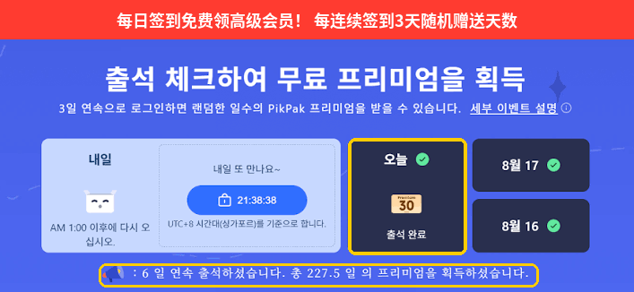
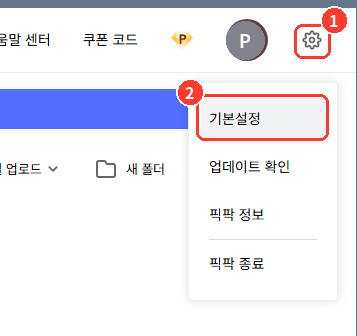
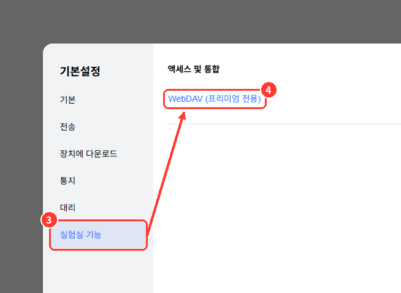
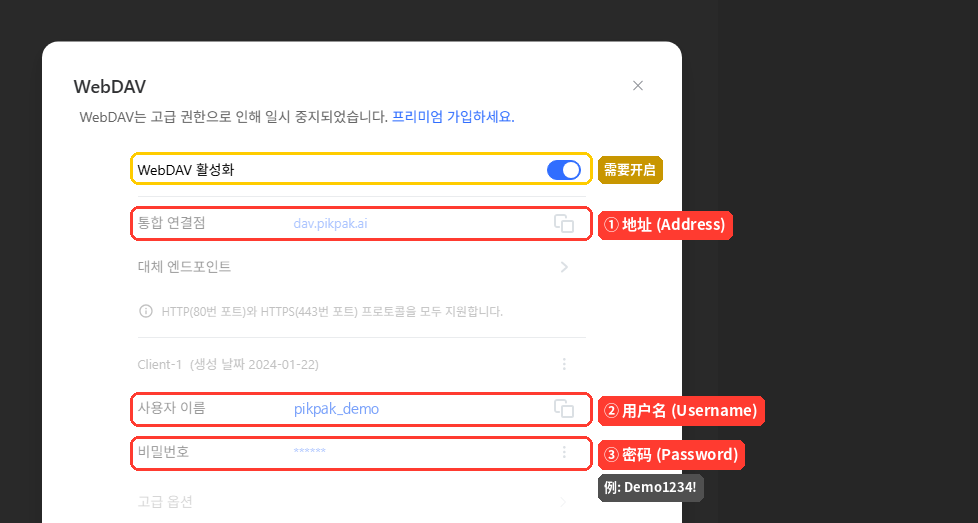
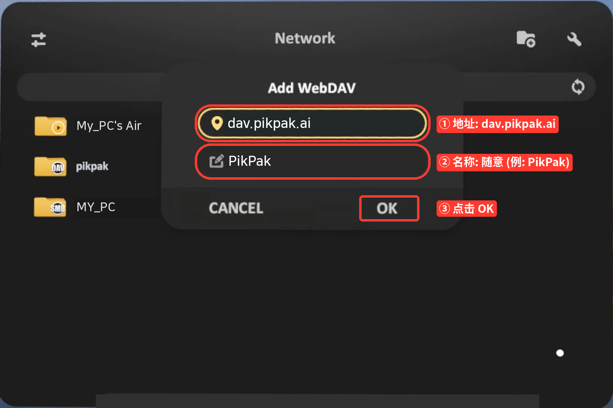
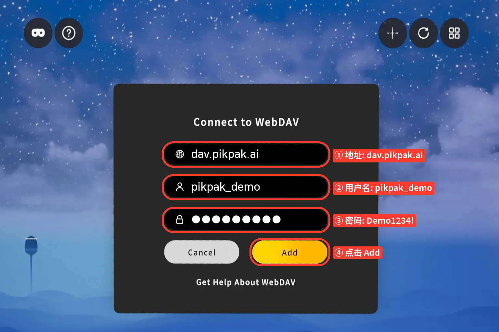

**🌐 [한국어](README.md) | [English](README.en.md) | [日本語](README.ja.md) | [简体中文](README.zh-CN.md)**

# PikPak 完全使用指南

> 基准日期：2026-11-25
> 标有 `[待确认]` 的内容尚未通过官方资料确认。
> 截图来自韩语版应用界面，你所用语言的菜单名称可能略有不同。

> [!TIP]
> **第一次注册的话，请填写邀请码 `64342028`。**
> 👉 [通过邀请链接注册](https://mypikpak.com/drive/activity/invited?invitation-code=64342028)

## 目录

1. [什么是PikPak](#什么是pikpak)
2. [注册与安装](#注册与安装)
3. [邀请码](#邀请码)
4. [每日签到免费领高级会员](#每日签到免费领高级会员)
5. [文件上传与下载](#文件上传与下载)
6. [云下载](#云下载)
7. [分享](#分享)
8. [视频播放](#视频播放)
9. [查看WebDAV账号](#查看webdav账号)
10. [在4XVR中连接PikPak](#在4xvr中连接pikpak)
11. [套餐对比](#套餐对比)
12. [使用技巧](#使用技巧)
13. [注意事项](#注意事项)
14. [来源](#来源)

---

## 什么是PikPak

PikPak 是一款**只要放入链接，就由云端代替你的电脑下载并保存文件的云盘**。由新加坡的 PIKCLOUD PTE. LTD. 运营，保存后的文件可以直接预览图片、播放视频。

与 Google Drive、OneDrive 等普通云盘相比，主要区别如下：

- **云下载：** 无需让电脑一直开着，服务器会替你下载。
- **即时播放：** 保存的视频无需下载，可在网页或应用中在线播放。
- **支持 WebDAV：** 可在 VR 播放器或文件管理应用中像本地磁盘一样打开 PikPak（仅限高级会员）。
- **Telegram 机器人：** 在 Telegram 中把文件或链接发给机器人，即可保存到 PikPak。
- **保险箱（Vault）：** 2.0 版本新增的端到端加密私人空间，可用密码或生物识别打开。

最新功能（iOS 2.3.0，2026年11月7日）是 **AI 字幕自动生成与翻译**。

---

## 注册与安装

在网页（mypikpak.com）或手机应用中，用邮箱或 Google 账号注册。注册即可获得 **6GB 免费空间**。注册时别忘了填写[邀请码](#邀请码)。

| 设备 | 下载渠道 | 备注 |
| --- | --- | --- |
| 网页 | mypikpak.com 网页版 | 无需安装 |
| iPhone / iPad | App Store | iOS 15.0 及以上 |
| Android | Google Play `[待确认]` | 另有 Android TV 版 `[待确认]` |
| Windows / macOS | 官方网站 `[待确认]` | 适合批量下载多个文件 |
| 浏览器扩展 | `[待确认]` | 在网页上直接保存链接 |

> [!WARNING]
> 请务必只从**官方应用商店或官方网站**安装应用。名字相似的修改版 APK 有账号被盗的风险。

---

## 邀请码

注册时请通过下方链接进入，或直接填写邀请码。

| 方式 | 内容 |
| --- | --- |
| 通过链接注册 | [https://mypikpak.com/drive/activity/invited?invitation-code=64342028](https://mypikpak.com/drive/activity/invited?invitation-code=64342028) |
| 直接填写邀请码 | **`64342028`** |

邀请奖励的具体内容 `[待确认]`。

---

## 每日签到免费领高级会员

> [!IMPORTANT]
> ### 每天签到，免费领取高级会员
> 👉 **[https://mypikpak.com/ko/check-in?from_source=pp_browser_extension](https://mypikpak.com/ko/check-in?from_source=pp_browser_extension)**

**连续签到（登录）3天，即可获得随机天数的高级会员**。坚持下来能攒不少。下图是连续签到6天、当天获得30天高级会员的例子。

- 签到在 **新加坡时间（UTC+8）零点** 重置，也就是北京时间零点。
- 把签到页面加入书签，每天点一次就好。

---

## 文件上传与下载

上传自己的文件有三种方法：

1. 在应用或网页中点击 **上传** 按钮并选择文件。
2. 在手机相册或其他应用中选择 **分享 → PikPak**。
3. 在 Telegram 中把文件转发给 **PikPak 机器人**。

要保存到设备上，长按文件并选择 **下载** 即可。

- iPhone 应用不支持批量下载多个文件。开发者也建议这种情况使用 **Windows 应用**（App Store 评论回复，2023年）。
- 据说免费用户有上传配额和下载速度限制，具体数值 `[待确认]`。

---

## 云下载

这是 PikPak 的核心功能（也叫离线下载）。放入文件链接后，**PikPak 服务器会替你下载并保存到网盘**。即使关闭应用也会继续下载。

### 使用步骤

1. 在应用或网页中点击 **+（添加）** 按钮，选择 **添加链接**。`[待确认：菜单名称]`
2. 粘贴要下载的文件链接。
3. 点击 **确认**，云端开始下载。
4. 完成后文件会出现在网盘中，可直接播放或下载。

### 支持的链接

- 普通文件链接（HTTP/HTTPS）
- 磁力链接、种子文件
- 部分社交媒体视频链接

免费用户每日及总计的云下载次数限制 `[待确认]`。

### 推荐用法（合法示例）

- 像 Linux ISO 这样**由官方通过种子发布的大文件**
- **公有领域或 CC 许可**的视频和资料
- 自己拥有版权的文件，或朋友正式分享给你的文件

> [!TIP]
> **智能增量保存**（2.2.0）：再次保存同一文件夹时只保存新文件，不会产生重复。

---

## 分享

选中文件或文件夹后点击 **分享**，即可生成分享链接。密码、有效期等详细选项 `[待确认]`。

- **分享动态标签页**（2.2.0）：在首页查看你关注的分享的最新动态。
- **管理分享**（2.3.0）：在“分享”菜单中集中管理你关注的分享。
- **保险箱加密分享**（2.0）：保险箱中的文件也可以在加密状态下分享。

> [!NOTE]
> 保存他人的分享链接前，请先确认内容是否合法。违法内容可在应用内举报。

---

## 视频播放

保存的视频无需下载即可直接播放。分辨率会根据网络自动调整，据说最高支持 4K `[待确认]`。

- **AI 字幕**（2.3.0）：自动生成并翻译字幕，还可以设置字幕优先级。
- **双指缩放**（2.1.1）：在播放器中用两根手指放大。
- **在线解压**（2.1.1）：可在线直接打开更多压缩格式。

想在 VR 大屏上观看，可以通过下方的 [WebDAV](#查看webdav账号) 连接。

---

## 查看WebDAV账号

使用 WebDAV，可以在 4XVR 等 VR 播放器或文件管理应用中像本地磁盘一样打开 PikPak。连接需要 **地址、用户名、密码** 三项。

> [!IMPORTANT]
> WebDAV 是 **高级会员专属** 功能。高级会员到期后，WebDAV 也会暂停。

> 截图中的账号（`pikpak_demo` / `Demo1234!`）仅为示例。实际请使用你自己界面上显示的值。

### 第1步. 打开基本设置

在电脑客户端（或网页）右上角点击 **齿轮图标（①）**，选择 **基本设置（기본설정）（②）**。

### 第2步. 实验室功能 → WebDAV

在左侧菜单点击 **实验室功能（실험실 기능）（③）**，再点击右侧的 **WebDAV（仅限高级会员）（④）**。

### 第3步. 查看连接信息

确认 **启用 WebDAV（WebDAV 활성화）** 已开启，然后记下以下三个值。

| 编号 | PikPak 中的名称 | 连接时填写的栏位 | 示例 |
| --- | --- | --- | --- |
| ① | 统一连接点（통합 연결점） | 地址 (Address) | `dav.pikpak.ai` |
| ② | 用户名（사용자 이름） | 用户名 (Username) | `pikpak_demo` |
| ③ | 密码（비밀번호） | 密码 (Password) | `Demo1234!` |

- 这里的密码 **不是 PikPak 登录密码**，而是此窗口中显示的 WebDAV 专用密码。可通过密码行右侧的 **⋮ 菜单** 查看或新建。`[待确认：菜单名称]`
- 点击地址右侧的复制按钮即可复制地址。
- 同时支持 HTTP（80 端口）和 HTTPS（443 端口）。

---

## 在4XVR中连接PikPak

在 [4XVR](https://www.4xvr.net/kor/h-nd-131.html) 播放器中填入上面查到的账号，就能在 VR 中直接观看 PikPak 里的视频。

### 第1步. 添加 WebDAV 服务器

在 **Network（网络）** 页面点击右上角的 **+** 按钮，选择 **WebDAV**，会弹出 **Add WebDAV** 窗口。

| 栏位 | 填写内容 |
| --- | --- |
| ① 地址栏 | `dav.pikpak.ai`（PikPak 的 **统一连接点**） |
| ② Server Name (Optional) | 任意名称，例如 `PikPak`（可留空） |
| ③ OK | 点击保存 |

### 第2步. 输入账号并连接

打开刚添加的服务器，会弹出 **Connect to WebDAV** 窗口。按 PikPak 中查到的值原样填写。

| 栏位 | 填写内容 | 示例 |
| --- | --- | --- |
| ① Address | PikPak **统一连接点** | `dav.pikpak.ai` |
| ② Username (Optional) | PikPak **用户名** | `pikpak_demo` |
| ③ Password (Optional) | PikPak WebDAV **密码** | `Demo1234!` |
| ④ Add | 点击连接 | |

连接成功后，网络列表中会出现 PikPak 文件夹，里面的视频可以直接在 VR 中播放。

### 无法连接时

- 确认 PikPak **高级会员仍有效**，并且 WebDAV 窗口中的 **启用 WebDAV** 已开启。
- 用户名和密码必须是 **WebDAV 窗口中显示的值**，不是 PikPak 的登录邮箱和密码。
- 地址请务必使用 **你自己 PikPak 界面上的统一连接点**。旧界面或其他教程中可能显示为 `dav.mypikpak.com`。连不上时，请尝试 WebDAV 窗口中 **备用连接点（대체 엔드포인트）** 里的地址。`[待确认]`
- 只填地址连不上时，可以试试在前面加上 `https://`。`[待确认]`

---

## 套餐对比

免费版 6GB，高级会员 10TB。价格因国家而异。付费前，不妨先通过[每日签到](#每日签到免费领高级会员)免费领取高级会员。

| 类型 | 存储空间 | 价格（美国 App Store，截至 2026-11-25） |
| --- | --- | --- |
| 免费 | 6GB | 免费 |
| Premium 月付 | 10TB | $4.99 / 月 |
| Premium 年付 | 10TB | $49.99 / 年 |
| Global Premium 月付 | 10TB `[待确认]` | $9.99 / 月 |
| Global Premium 年付 | 10TB `[待确认]` | $99.99 / 年 |
| 10TB 额外空间 | +10TB | $43.49 / 1年 |

- 同一 App Store 页面的说明文字写的是每月 $10.0、每年 $100.99，与购买列表价格不同。`[待确认]`
- 官方帮助中心有单独页面说明 **Global Premium 与 Regional Premium 的区别**（如可用地区等），详细内容 `[待确认]`。
- 保险箱（Vault）空间可以另外购买（2.1.1）。

---

## 使用技巧

- **每日签到：** 每连续签到3天可获得高级会员天数。[前往](#每日签到免费领高级会员)
- **Telegram 机器人：** 无需打开应用，把链接发给机器人即可保存。
- **批量下载用电脑客户端：** 比手机端方便得多。
- **更改启动页**（2.2.1）：可设置应用直接打开“文件”页面。
- **在 VR 中观看：** 通过 WebDAV 连接 4XVR，即可在 VR 中直接播放。[前往](#在4xvr中连接pikpak)

---

## 注意事项

### 版权

- 请**不要下载或分享未经权利人许可的文件**，例如电影、电视剧、付费软件等。即使是云端下载的，侵权责任也在使用者本人。
- 违规时的账号限制政策 `[待确认]`

### 安全与隐私

- 请**只在官方应用或官方网站**购买高级会员。PikPak 官方博客也发文提醒不要从非官方渠道购买。
- **不要把 WebDAV 密码给别人看。** 发布截图时请遮住用户名和密码。
- 根据 App Store 的隐私信息，应用会使用 **用于追踪的标识符**，并将 **邮箱和手机号** 与账号关联。
- 敏感文件请放入 **保险箱（Vault）**。更改或重置保险箱密码时会收到邮件提醒（2.1.1）。
- 是否支持两步验证 `[待确认]`
- 有用户反映曾出现服务故障，**重要原始文件请在其他地方另做备份**。

---

## 来源

- [App Store: PikPak - Cloud Storage & Saver](https://apps.apple.com/us/app/pikpak-cloud-storage-saver/id1616861537)（功能说明、应用内购买价格、版本记录、隐私信息。2026-11-25 确认）
- [4XVR: WebDAV 连接](https://www.4xvr.net/kor/h-nd-131.html)（在 4XVR 中添加 WebDAV 服务器的步骤）
- [AxeeTech: PikPak Review 2026](https://axeetech.com/pikpak-review/)（支持设备、链接类型、4K 播放等。第三方评测，2026-11-13 更新）
- PikPak 电脑客户端界面（WebDAV 菜单位置、签到页面。2026-11-25 截图，账号信息已替换为示例）
